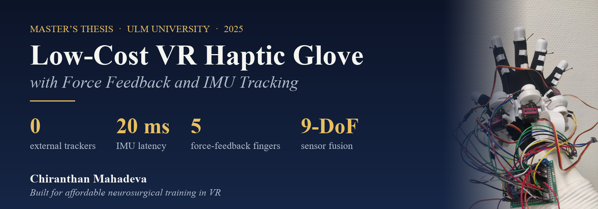
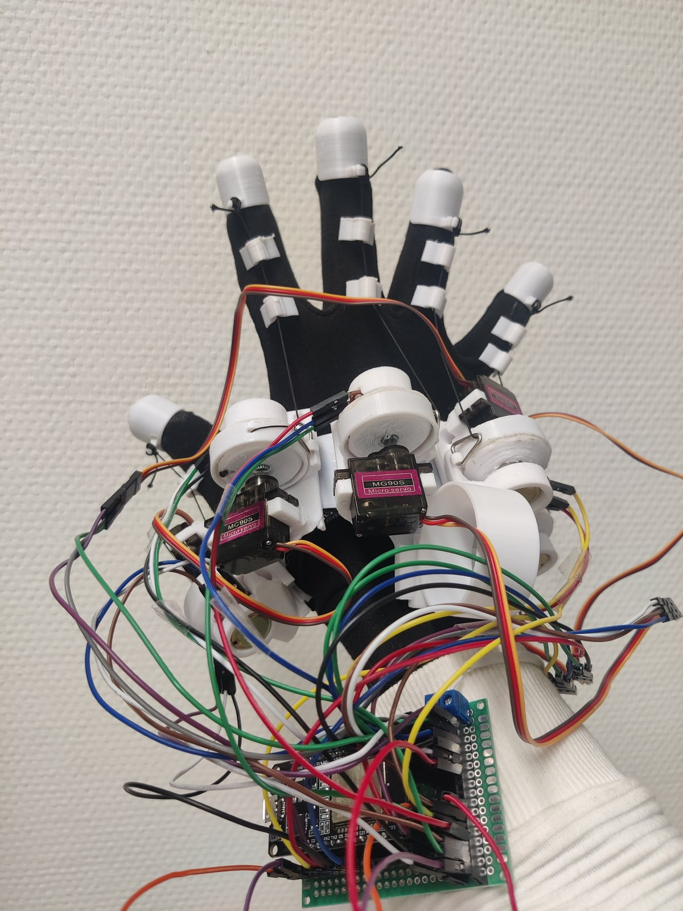
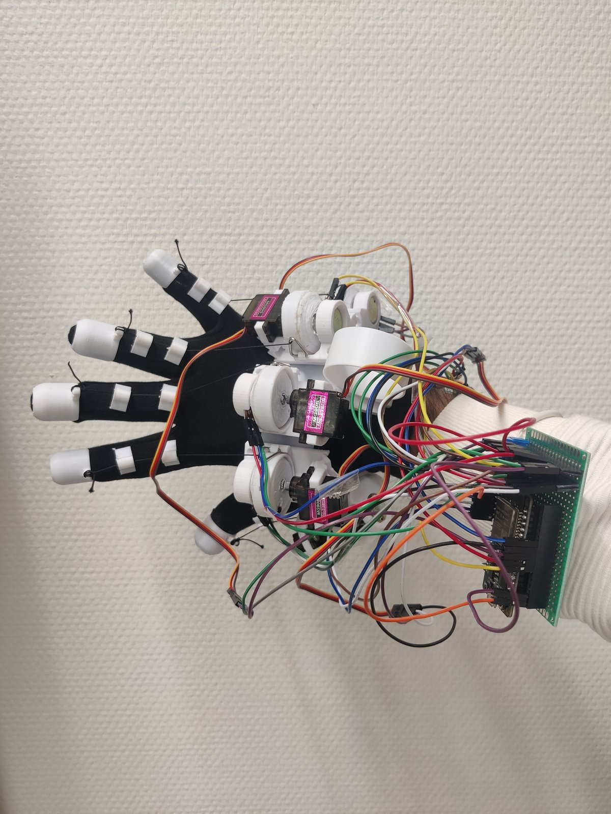
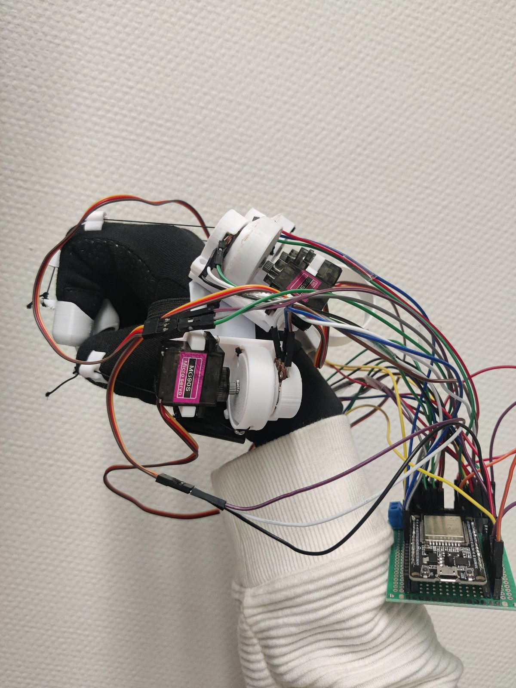
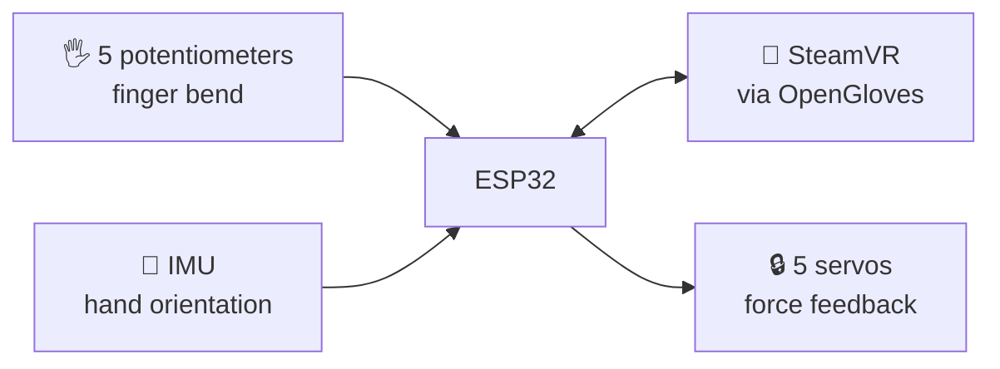

  

  
  
  
  

  <b>A wireless DIY glove that tracks every finger, pushes back when you touch a virtual object, 
  and knows how your hand is turned using a single IMU, without any external tracker.</b>

  
  
  

📄 <a href="thesis/Thesis_Report.pdf"><b>Read the full thesis</b></a>

## 💡 The idea

Commercial haptic gloves are expensive, mostly vibrate instead of giving real force, and often need cables or external trackers.
This glove builds on the open-source [LucidGloves](https://github.com/LucidVR/lucidgloves) design and **replaces the external Vive tracker with an IMU**,
making a self-contained glove for **VR neurosurgical training**.

## ⚙️ How it works

| | |
|:--:|---|
| 🖐️ | **Fingers:** strings on spools turn a potentiometer for each finger |
| 🔒 | **Force feedback:** servos lock the spools when you grab a virtual object |
| 🧭 | **Hand orientation:** IMU fused with a quaternion filter (no gimbal lock) |
| 📡 | **Wireless:** ESP32 streams everything to SteamVR through OpenGloves |

## 📊 Results

Tested against an HTC Vive Tracker as ground truth:

| IMU | Best roll error | Best pitch error | Best yaw error | Latency |
|---|:--:|:--:|:--:|:--:|
| 🏆 **ICM20948** (9-DoF) | **16.1°** | 17.5° | **29.5°** | **20 ms** |
| MPU6050 (6-DoF) | 17.1° | **14.5°** | 77.7° | 492 ms |

✅ The **ICM20948 wins**: its magnetometer keeps yaw under control, and it responds about **24× faster**. 
✅ **Quaternion and Kalman filters** are the most accurate; the quaternion filter is also lighter and avoids gimbal lock. 
⚠️ An IMU alone still drifts in yaw and position, so it doesn't fully replace an optical tracker yet.

## 📚 Read more

| Chapter | |
|---|---|
| [1. Background](docs/01_background.md) | Why VR for neurosurgery, and what current gloves lack |
| [2. Hardware](docs/02_hardware.md) | Parts list, 3D-printed parts, assembly and wiring |
| [3. Sensor fusion](docs/03_sensor_fusion.md) | Complementary, Kalman and quaternion filters explained |
| [4. Position tracking](docs/04_position_tracking.md) | Turning acceleration into position, and why it drifts |
| [5. Results](docs/05_evaluation.md) | Full test setup, error tables and conclusions |
| [References](docs/REFERENCES.md) | All sources used in the thesis |

## 🎓 About

**Chiranthan Mahadeva**, Master's thesis in Computer Science, Ulm University, Institute of Distributed Systems, March 2025. 
Supervisor: Mostafa Yehia, M.Sc. Examiners: Prof. Dr. rer. nat. Frank Kargl and Prof. Dr.-Ing. Christian Damm.

Built on [LucidGloves](https://github.com/LucidVR/lucidgloves) and [OpenGloves](https://github.com/LucidVR/opengloves-driver).
To cite this work, use the **"Cite this repository"** button on the right.
