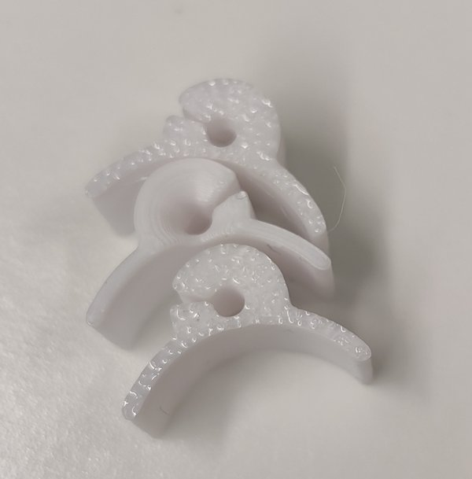
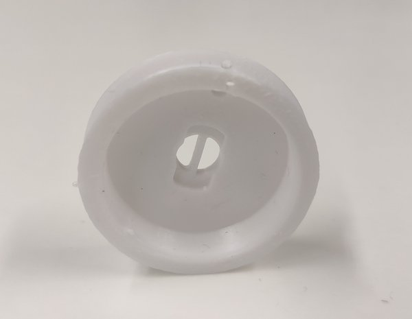
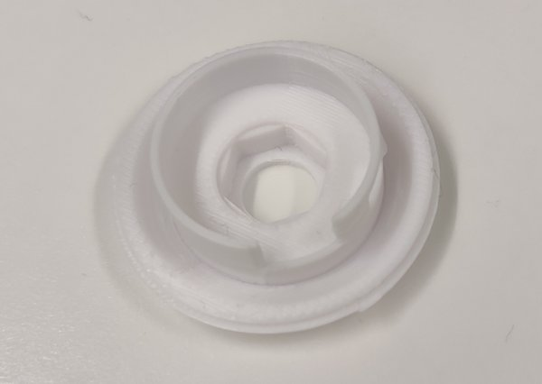
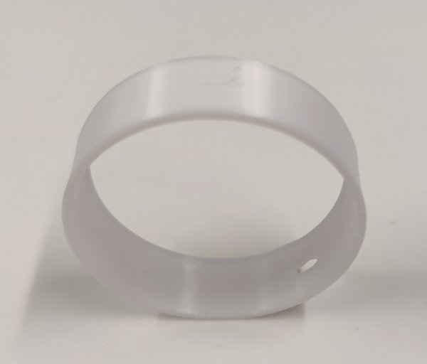
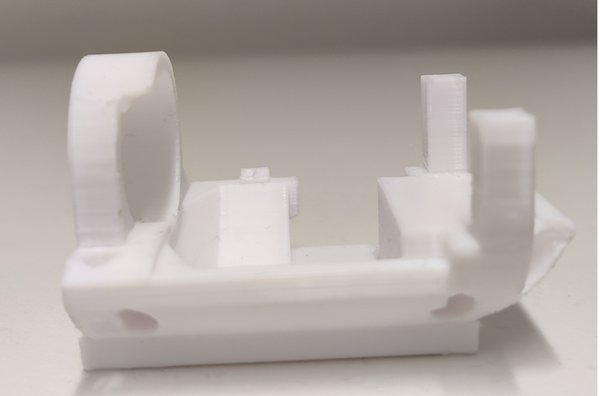
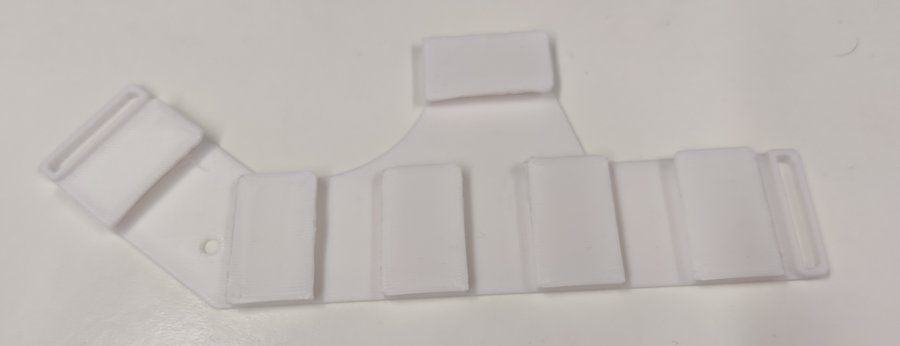
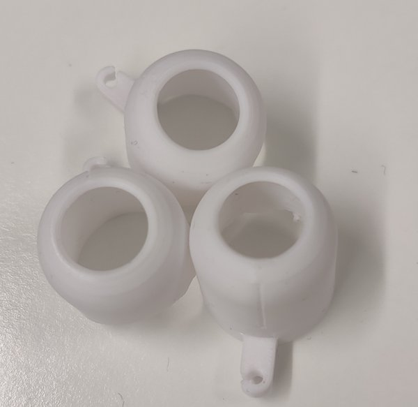
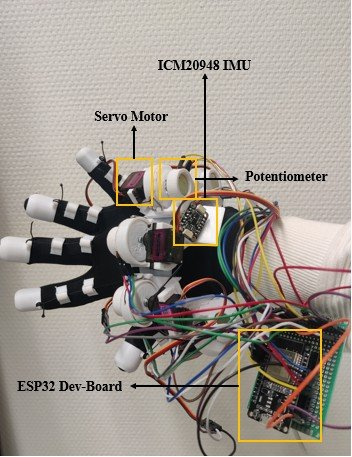
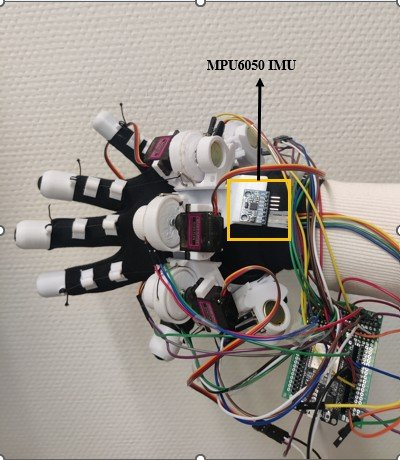
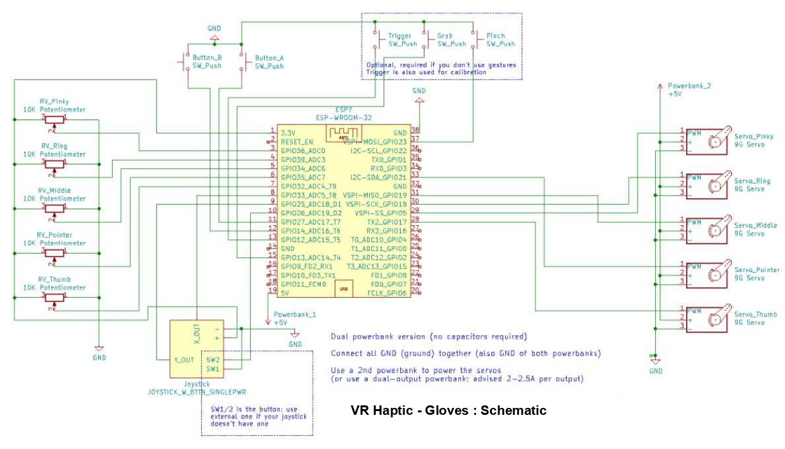

# 2. Hardware

[← 1. Background](01_background.md) · [README](../README.md) · Next: [3. IMU sensor fusion →](03_sensor_fusion.md)

> Summary of thesis chapter 3. The design follows the open-source [LucidGloves](https://github.com/LucidVR/lucidgloves) project, with the Valve Index controller / Vive tracker replaced by an IMU.

## How it works

- **Finger tracking:** each finger pulls a string wound on a spool. The spool turns a **potentiometer**, and the ESP32 reads its voltage as how far the finger is bent.
- **Force feedback:** a **servo** next to each spool can block it. When the virtual hand grabs an object, the servos stop the fingers from closing further. Cheap **retractable badge reels** act as return springs.
- **Hand orientation and position:** an **IMU** on the back of the hand, connected over I²C.
- **Connection:** an **ESP32-WROOM-32** sends the data wirelessly to SteamVR through the **OpenGloves** driver.

## Bill of materials

| Component | Quantity |
|---|---|
| PLA filament (3D printing) | 1 kg spool |
| MG90S 9 g servo motors | 5 per hand |
| ESP32-WROOM-32 development board | 1 per hand |
| WL (brass) 10 kΩ potentiometers | 5 per hand |
| Retractable badge reels | 5 per hand |
| Power supply (5 V power bank) | 1 per hand |
| Sports gloves | 1 pair |
| WD-40 (lubricant) | 1 |
| Velcro fasteners | 1 |
| ICM20948 IMU (9-DoF) | 1 |
| MPU6050 IMU (6-DoF) | 1 |

Only one IMU is needed for a working glove. Both were bought here so they could be compared.

## 3D-printed parts

Printed on a Monoprice V1 with PLA (nozzle 200 °C, bed 65 °C). Early prints warped; lowering the print speed and adjusting the cooling fixed it.

| Part | Qty per hand | Purpose |
|---|---:|---|
| Guide nodes | 15 | Guide the strings along the finger |
| Spools | 5 | Wind and unwind the strings |
| Tensioners | 5 | Keep the strings tight for controlled feedback |
| Covers | 5 | Protect the mechanism from dust and damage |
| Holders | 5 | Hold the potentiometer, spool and servo |
| Rigid mount | 1 | Base plate on the back of the hand |
| End caps | 5 | Fix the string at the fingertip |

<table>
<tr>
<td align="center"> Guide node</td>
<td align="center"> Spool</td>
<td align="center"> Tensioner</td>
<td align="center"> Cover</td>
</tr>
<tr>
<td align="center"> Holder</td>
<td align="center" colspan="2"> Rigid mount</td>
<td align="center"> End cap</td>
</tr>
</table>

## Assembly

1. Fit each **potentiometer** into its holder (round hole for WL potentiometers).
2. Remove the metal loops from the badge-reel ends with pliers, clamp them onto the plastic loops of the holders, and run the strings through them.
3. Glue a layer of **foam** under the rigid mount for comfort. An elastic loop through the two round holes in front of the thumb is optional.
4. Attach a **Velcro strap** between the two loops of the rigid mount and trim it for a snug fit.
5. Slide the modules onto the rigid mount. Move some of them back if needed so the strings line up. Glue the guide nodes and end caps.
6. **Flash the firmware first**, check that finger tracking works, and only then install the haptics.
7. Fit the **servos** into their slots with a single-arm servo horn. Calibrate with *extend/retract servos* in the OpenGloves UI:
   fully extended, the servos must stop the hand from closing; fully retracted, they must not restrict it at all.

  
  
   Assembled glove with the ICM20948 (left) and the MPU6050 (right) mounted

## Wiring

### Finger potentiometers → ESP32 ADC
Each 10 kΩ potentiometer: one end to **GND**, the other to **3.3 V**, wiper (middle pin) to an ADC pin.

| Finger | ESP32 pin |
|---|---|
| Pinky | GPIO36 (ADC0) |
| Ring | GPIO39 (ADC3) |
| Middle | GPIO34 (ADC6) |
| Pointer | GPIO35 (ADC7) |
| Thumb | GPIO32 (ADC4) |

### Servos → ESP32 PWM
Servos are powered from a **second power bank (+5 V)**. All grounds are connected together.

| Finger | ESP32 pin |
|---|---|
| Pinky | GPIO13 |
| Ring | GPIO12 |
| Middle | GPIO14 |
| Pointer | GPIO27 |
| Thumb | GPIO26 |

### IMU → ESP32 I²C

| IMU pin | ESP32 |
|---|---|
| SDA | GPIO21 |
| SCL | GPIO22 |
| VCC | 3.3 V |
| GND | GND |

### Schematic

Two power banks are used: one for the ESP32 and one for the servos (or a single dual-output bank, 2–2.5 A per output), so no capacitors are needed.
The joystick and the buttons (A, B, trigger, grab, pinch) come from the LucidGloves design and are optional.

---

[← 1. Background](01_background.md) · [README](../README.md) · Next: [3. IMU sensor fusion →](03_sensor_fusion.md)
