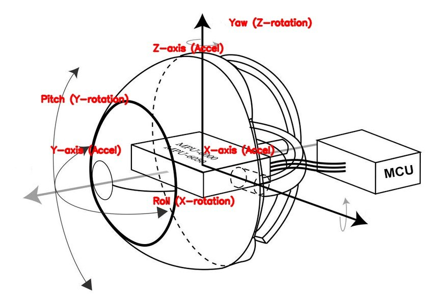
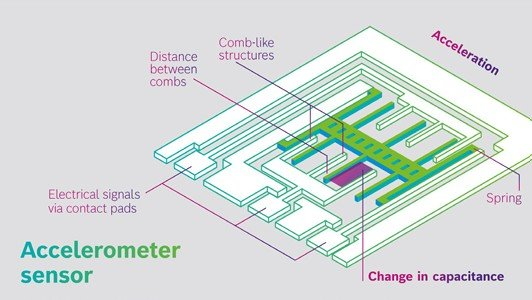
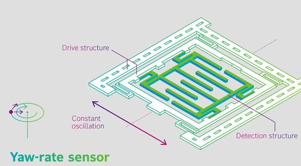
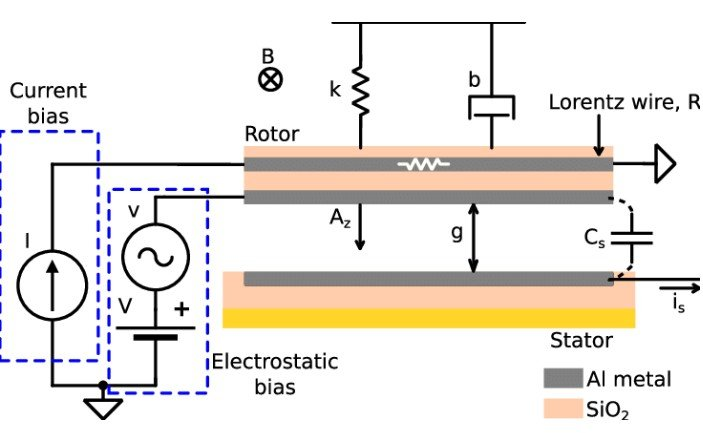
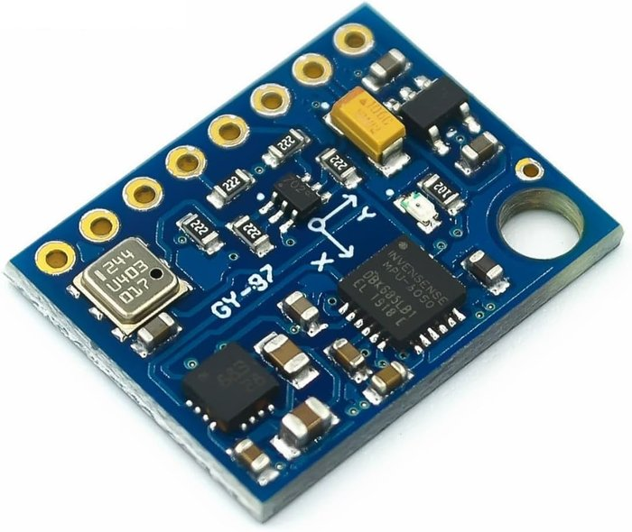
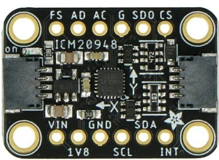
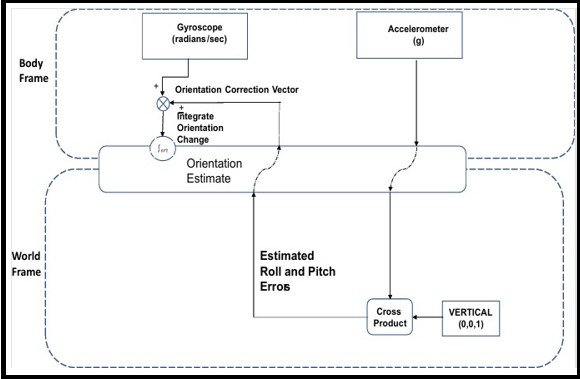
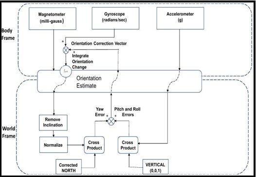

# 3. IMU Sensor Fusion

[← 2. Hardware](02_hardware.md) · [README](../README.md) · Next: [4. Position tracking →](04_position_tracking.md)

> Summary of thesis chapters 4–5. The thesis works up from basic to advanced filters: accelerometer only, gyroscope only, complementary filter, Kalman filter, and finally a **quaternion-based complementary filter** that fixes both drift and gimbal lock.

## 3.1 What an IMU measures

| Sensor | Measures | Strength | Weakness |
|---|---|---|---|
| **Accelerometer** | Linear acceleration (and gravity) | Absolute "down" reference → roll and pitch | Noisy; can't tell gravity from movement; no yaw |
| **Gyroscope** | Angular velocity | Smooth, responsive short-term rotation | **Drifts**: small errors add up over time |
| **Magnetometer** | Earth's magnetic field | Absolute heading (compass) → yaw | Disturbed by metal and nearby electronics |

<table><tr>
<td align="center"> MEMS accelerometer</td>
<td align="center"> MEMS gyroscope</td>
<td align="center"> MEMS magnetometer</td>
</tr></table>

**Degrees of freedom:** a 3-DoF IMU has only an accelerometer. A **6-DoF** IMU adds a gyroscope. A **9-DoF** IMU also has a magnetometer, which gives an absolute reference for correcting yaw drift.

### Choosing the IMUs

| IMU | DoF | Interface |
|---|---|---|
| BNO085 | 9 | I²C / SPI |
| BMI270 | 6 | I²C / SPI |
| BMI160 | 6 | I²C / SPI |
| **ICM20948** ✔ | 9 | I²C / SPI |
| **MPU6050** ✔ | 6 | I²C |
| MPU9250 | 9 | I²C |

<table><tr>
<td align="center"> MPU6050: cheap 6-DoF</td>
<td align="center"> ICM20948: 9-DoF with AK09916 magnetometer, lower power, SPI capable</td>
</tr></table>

## 3.2 Why a single sensor isn't enough

**Accelerometer only:** roll and pitch come from the direction of gravity:

$$\phi = \arctan\left(\frac{a_y}{\sqrt{a_x^2 + a_z^2}}\right) \qquad \theta = \arctan\left(\frac{-a_x}{\sqrt{a_y^2 + a_z^2}}\right)$$

There's no yaw, and any hand movement or vibration corrupts the result.

**Gyroscope only:** integrate the angular velocity:

$$\phi_t = \phi_{t-1} + \omega_x \Delta t \qquad \theta_t = \theta_{t-1} + \omega_y \Delta t \qquad \psi_t = \psi_{t-1} + \omega_z \Delta t$$

It's smooth and responsive, but small errors accumulate into **drift**, and there's no absolute reference to correct them.

→ The accelerometer is good for **long-term stability** and the gyroscope for **short-term precision**. Sensor fusion combines the two.

## 3.3 Complementary filter

Blends a high-pass-filtered gyroscope estimate with a low-pass-filtered accelerometer estimate:

$$\phi_{final} = \alpha\,(\phi_{gyro} + \omega \Delta t) + (1-\alpha)\,\phi_{accel}, \qquad \alpha \approx 0.98$$

✅ Simple and fast · ❌ no yaw without a magnetometer · ❌ fixed $\alpha$ doesn't adapt to changing motion · ❌ assumes linear sensor behaviour

## 3.4 Kalman filter

Weights the sensors dynamically according to their estimated noise:

1. **Predict** the state from the previous state and the gyroscope: $x_k = A x_{k-1} + B u_k + w_k$
2. **Correct** it with the accelerometer (and magnetometer) measurement: $x_k = x_k + K (z_k - H x_k)$

✅ Adaptive weighting, strong drift correction, robust under fast motion · ❌ heavier to compute · ❌ noise covariances must be tuned · ❌ **still uses Euler angles, so gimbal lock remains**

## 3.5 Quaternion-based complementary filter (the approach used here)

**Gimbal lock** happens when two rotation axes line up and one degree of freedom is lost. **Quaternions** (4 values: $w, x, y, z$) represent orientation without that singularity. The thesis uses a quaternion complementary filter that:

- has **no gimbal lock** in any orientation
- needs **no trigonometric functions and no division** in the update, so it runs fast on the ESP32
- never needs re-orthogonalisation (unlike a 3×3 rotation matrix) and almost never needs re-normalisation
- keeps correcting drift no matter how long the hand stays in one orientation

### Fast gyroscope update (small-angle approximation)

$$t_2 = \frac{\Delta t}{2}, \quad Q_x = g_x t_2, \quad Q_y = g_y t_2, \quad Q_z = g_z t_2, \quad Q_w = 1 - \tfrac{1}{2}(Q_x^2 + Q_y^2 + Q_z^2)$$

$$Q_{current} = Q_{gyro} \otimes Q_{last}$$

### 6-DoF: accelerometer corrects roll and pitch drift

1. **Rotate the accelerometer reading into the world frame:** $V_{earth} = Q \otimes V_{body} \otimes Q^{*}$
2. **Find the error** against true vertical $g = (0,0,1)$: $V_{corr} = V_{earth} \times g$ (zero vector means no error)
3. **Scale it down** to avoid jumps: $V_{corr} \leftarrow \alpha\,V_{corr}$, with $\alpha \approx 0.01 - 0.1$
4. **Rotate it back into the body frame and add it to the next gyroscope reading:** $V_{gyro,next} \mathrel{+}= Q^{*} \otimes V_{corr} \otimes Q$

The correction is fed in gradually (for example 1/400 per cycle in a 400 Hz loop), so short disturbances are filtered out while the orientation still converges.

### 9-DoF: magnetometer corrects yaw drift

The accelerometer can't see yaw, so the **magnetometer** adds a north reference. Together this is a **MARG** (magnetic, angular rate, gravity) filter:

1. Read the magnetometer and apply **hard-iron** calibration (subtract the constant bias from nearby magnets)
2. Apply **soft-iron** calibration (a 3×3 matrix that turns the distorted ellipsoid back into a sphere)
3. Rotate the reading into the world frame (tilt compensation)
4. Remove inclination (set the vertical component to zero) and normalise
5. Correct for magnetic declination if true north is needed
6. Cross product of the estimated north and the measured north gives the yaw error
7. Apply the error gradually to the gyroscope (a low-gain proportional controller)

### Quaternion → Euler angles (for comparison with the reference)

$$\psi = \operatorname{atan2}\big(2(q_x q_y + q_w q_z),\ 1 - 2(q_y^2 + q_z^2)\big)$$
$$\theta = \arcsin\big(2(q_x q_z - q_w q_y)\big)$$
$$\phi = \operatorname{atan2}\big(2(q_w q_x + q_y q_z),\ 1 - 2(q_x^2 + q_y^2)\big)$$

## Filter comparison

| | Complementary | Kalman | Quaternion complementary |
|---|---|---|---|
| Drift correction | Fixed weight | Adaptive | Gradual, world-frame |
| Yaw | ❌ (✅ with magnetometer) | ✅ with magnetometer | ✅ with magnetometer (9-DoF) |
| Gimbal lock | ❌ | ❌ | ✅ none |
| Computation | Very low | High | Low (no trigonometry in the update) |

---

[← 2. Hardware](02_hardware.md) · [README](../README.md) · Next: [4. Position tracking →](04_position_tracking.md)
