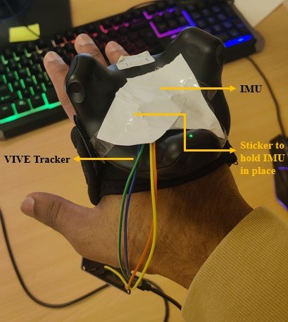
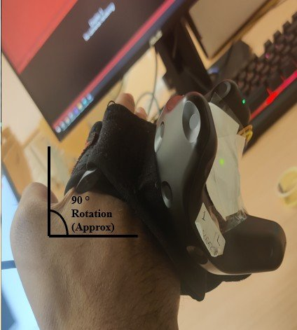
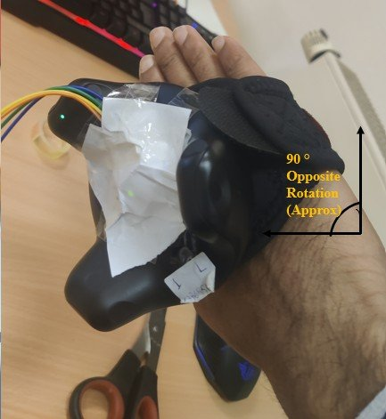

# 5. Evaluation & Results

[← 4. Position tracking](04_position_tracking.md) · [README](../README.md) · [References →](REFERENCES.md)

> Summary of thesis chapters 7–8.

## Test setup

The IMU was taped onto an **HTC Vive Tracker**, which served as ground truth, in the same position it has on the glove. This way both sensors went through exactly the same movement.

<table><tr>
<td align="center"> IMU attached to the Vive Tracker</td>
<td align="center"> ≈ +90° rotation</td>
<td align="center"> ≈ −90° rotation</td>
</tr></table>

**Orientation test:** the hand was rotated about +90°, −90° and 180° (upside down). Quaternions $(w, x, y, z)$ were recorded from both devices, repeated several times, once for each IMU.
**Position test:** the hand was moved along X, Y and Z, and positions were recorded from both devices.
**Metrics:** mean absolute error (MAE) against the Vive Tracker, and latency.

## Orientation accuracy

| IMU | Filter | Roll MAE | Pitch MAE | Yaw MAE |
|---|---|---:|---:|---:|
| **ICM20948** (9-DoF) | Quaternion | **16.12°** | 17.48° | 29.54° |
| | Complementary | 20.42° | 18.17° | 35.25° |
| | Kalman | 16.17° | 17.53° | **29.53°** |
| **MPU6050** (6-DoF) | Quaternion | 19.55° | **14.52°** | 79.24° |
| | Complementary | 21.50° | 19.00° | 88.44° |
| | Kalman | 17.05° | 16.85° | 77.69° |

## Latency

| Device | Latency |
|---|---:|
| HTC Vive Tracker (typical) | 2–5 ms |
| **ICM20948** | **20.2 ms** |
| MPU6050 | 492 ms |

## Findings

**ICM20948 vs MPU6050**
- The ICM20948 has lower error with every filter. The difference is largest for **yaw (≈ 30° vs ≈ 80°)**, because the MPU6050 has no magnetometer.
- At 492 ms, the MPU6050 is too slow for real-time VR. The ICM20948, at 20 ms, is usable.

**Filters**
- **Quaternion and Kalman filters give almost the same accuracy**; Kalman is slightly better in most cases.
- The **complementary filter is the least accurate**, especially in yaw.
- The quaternion filter matches the Kalman filter while also avoiding gimbal lock and costing less to compute.

**ICM20948 vs Vive Tracker**
- Roll and pitch are within ≈ 16–18°, yaw within ≈ 29–35°.
- Latency is about 15–18 ms higher. That can show as lag in very fast movements but is fine for many real-time tasks.

### Why are the errors this large?

The Vive Tracker uses external **Lighthouse base stations**, so it knows its absolute pose and never drifts.
The IMU only integrates its own sensors. When the hand stops moving, the filter assumes a steady state and slowly pulls the orientation back toward neutral, **especially in yaw**, while the Vive Tracker stays where it is.
That gap between the two shows up as a high MAE.

## Position tracking

MAE of the IMU position compared with the Vive Tracker over three trials:

| Trial | X | Y | Z |
|---|---:|---:|---:|
| 1 | 1.025 m | 1.024 m | 1.023 m |
| 2 | 1.065 m | 1.027 m | 1.027 m |
| 3 | 1.027 m | 1.029 m | 1.064 m |

Position error is about **1 m** on all axes. This is the expected result of **double integration** (see [chapter 4](04_position_tracking.md)): small acceleration errors grow into large position drift.
With a single IMU, position tracking isn't usable without an external reference.

## Conclusion

- An IMU can **replace the external tracker for hand orientation**, which makes the glove cheaper, more portable and fully self-contained.
- The **ICM20948 (9-DoF) is clearly the better choice**: more accurate and about 24× lower latency than the MPU6050.
- **Quaternion-based fusion** reaches Kalman-level accuracy without gimbal lock and at lower computational cost.
- It **doesn't yet match a professional optical tracker**: yaw error remains, and IMU-only position drifts.

**Future work:** better magnetometer calibration and correction, improved sensor-fusion methods, and adding external reference points for position.

Overall, the project shows that low-cost, open-source hardware can make VR-based medical training more accessible.

---

[← 4. Position tracking](04_position_tracking.md) · [README](../README.md) · [References →](REFERENCES.md)
